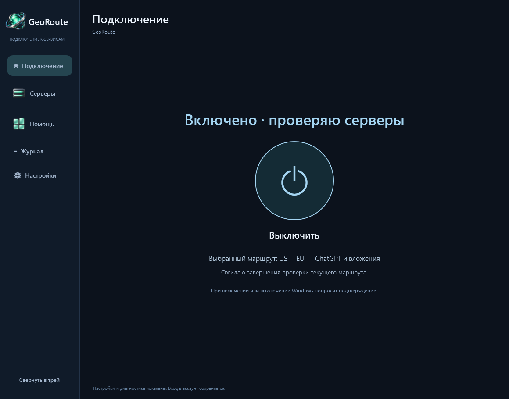
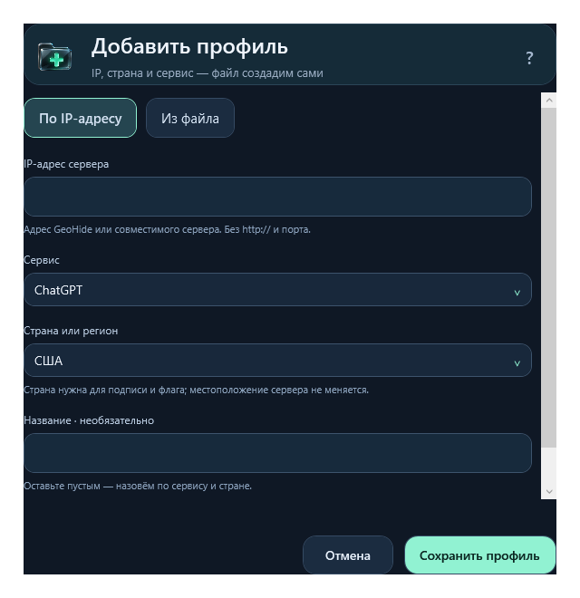
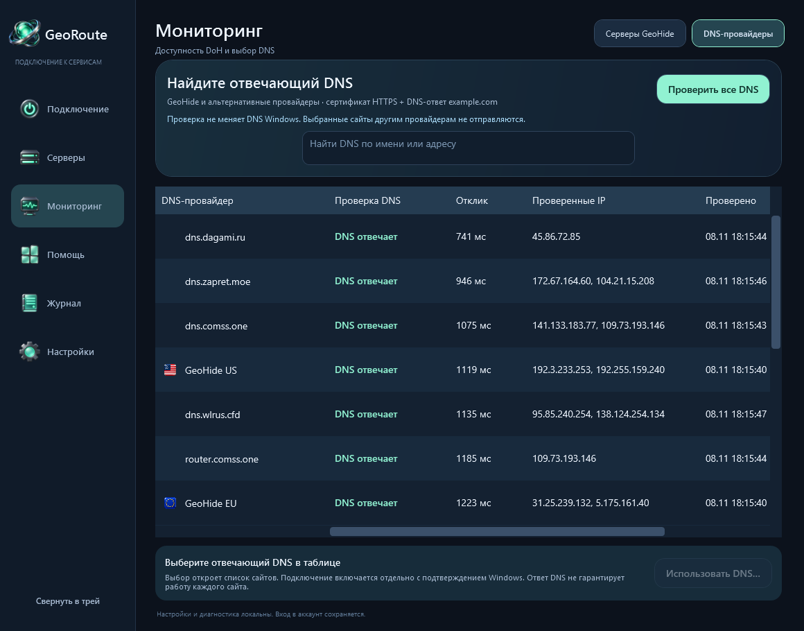

# GeoRoute

Windows desktop manager for ChatGPT and Gemini GeoHide routes and endpoint availability. [Русский](README.md).

**[Download for Windows](https://github.com/Georgy-hook/GeoRoute/releases/latest)**. Download **GeoRoute-Setup-0.5.0-x64.msi**, choose **Далее (Next) → Установить (Install)** in the Russian setup wizard, then open **GeoRoute** from the desktop or Start menu. Python and Java are not required. Requirements: Windows 10/11 x64, Windows PowerShell 5.1 and .NET Framework 4.8.

**VirusTotal snapshot (2026-11-08): zero detections** for the exact 0.5.0 MSI, ZIP and fourteen selected components. The MSI has 59 undetected results, 0 timeouts, 0 failures and 12 unsupported types; absence of detections is not a safety guarantee. [Reports, coverage, dates and hashes](docs/security/README.md).

The per-user installer creates shortcuts and a Windows uninstall entry. Exit GeoRoute through its tray menu before updating; profiles/settings/logs are retained. Disable the route and optional Bridge/proxy before uninstalling. The portable ZIP is an additional option: extract it fully and run `GeoRoute.cmd`. Portable and installed settings are separate.

Wait for the initial checks, choose an available route under **Servers**, then use the single **Enable / Disable** control on the home page and confirm the Windows elevation request. The interface is currently Russian.

In the next version (`develop`), server probes, US/EU/RU provider-list refresh and connection diagnostics run every two hours. **Settings → Automatic server checks** offers Never, 30 minutes, 1/2/6/12/24 hours (default: two hours). Choices persist and apply immediately, restarting the cooldown. Never also suppresses startup checks; manual checks remain available. An in-progress scan finishes normally. Observations remain usable between scans with a ten-minute allowance; with automation disabled they expire after two hours and ten minutes. Published 0.5.0 still probes servers every two minutes, connection health every five minutes, and provider lists hourly. Regional replacement is independent: an EU outage does not prevent updating US or RU profiles. Unavailable, retired and stale endpoints cannot unlock a managed profile. A mixed US+EU route requires both roles to pass. Healthy choices are retained; manual addresses survive provider refresh.

Monitoring has its own sidebar entry, overall and per-server loading indicators, and a single active scan. Every bundled GeoHide profile includes ChatGPT, Gemini and OpenAI files; the mixed route sends Gemini through EU. The retired Gemini-only cards are migrated away with a backup. Gemini failures are visible without disabling a working ChatGPT connection. Automatic selection prefers nodes without Google challenges. Managed profiles include the exact `www.google.com` verification frontend only after its same-node HTTPS or shared HTTP/2 route probe succeeds; this also routes Google Search on that hostname. Gmail, account login and other Google subdomains are not included.

Automatic selection updates saved profiles. Applying them to Windows requires an explicit connection action and elevation. The ordinary mode manages a marked section of `hosts`, not an all-traffic VPN. Closing the window keeps monitoring in the tray; exiting stops monitoring while applied hosts settings remain. Optional NextDNS Bridge and HTTP proxy features are not enabled automatically.

A green check proves the tested HTTPS transport/configuration only, not an authenticated ChatGPT conversation, a specific GIF download or computer-control session. Availability depends on the local network and GeoHide endpoints.

[Installation guide](docs/INSTALL.ru.md) · [Verification limits](docs/VERIFICATION.md) · [Development](docs/DEVELOPMENT.md) · [Changelog](CHANGELOG.md).

Based on [noVibe/DnsConf](https://github.com/noVibe/DnsConf). The upstream cloud DNS tools remain available separately: [technical manual](DNS-CONFIGURER.md). No NextDNS account or API key is needed for the ordinary desktop hosts mode. GeoRoute is an independent client, not an official GeoHide/NextDNS product.

Custom profiles: use the **?** button beside **Add server** for the in-app guide, or see the [file format and import limits](README.md#как-добавить-собственный-профиль). Import accepts `.hosts` files up to 1 MiB with 1–512 unique, supported exact domains. Importing adds a local profile without changing the active system configuration; selecting and connecting is a separate action. Custom profiles do not participate in automatic GeoHide endpoint replacement.

Create a profile without a file: **Servers → Add server → By IP**, enter a public server IP and choose the country, then save. One GeoHide profile includes ChatGPT, Gemini, OpenAI files and the exact Google verification frontend. A name is optional. Saving does not enable the route or verify connectivity; the supplied server must support these hosts. File import remains available as a separate input mode.

Available since 0.5.0: **Servers → Sites and DNS** routes only selected namespaces through GeoHide EU/US/RU or a custom HTTPS DoH endpoint. All other DNS stays unchanged. Includes a searchable GeoHide catalogue, custom domains, certificate-validated probes and a separate LocalService/NRPT route. [Scope and technical details](docs/SELECTIVE-DNS.md).

**Monitoring → DNS providers** performs read-only HTTPS DoH checks with certificate validation and a DNS answer for the fixed public `example.com`. Your site list is not sent to other candidates. Per-row loading, latency, checked bootstrap IPs, time and failures are visible; healthy results sort first. Select a successful result under five minutes old → **Use DNS…** to open the existing site list with that provider. Enabling it remains a separate elevated action. A healthy DNS transport does not guarantee support for any particular service. The saved custom DoH endpoint is also included. Both monitoring tables resize with the window.

*GeoRoute screen with local checks from 2026-11-08; availability and latency vary by network and time.*
