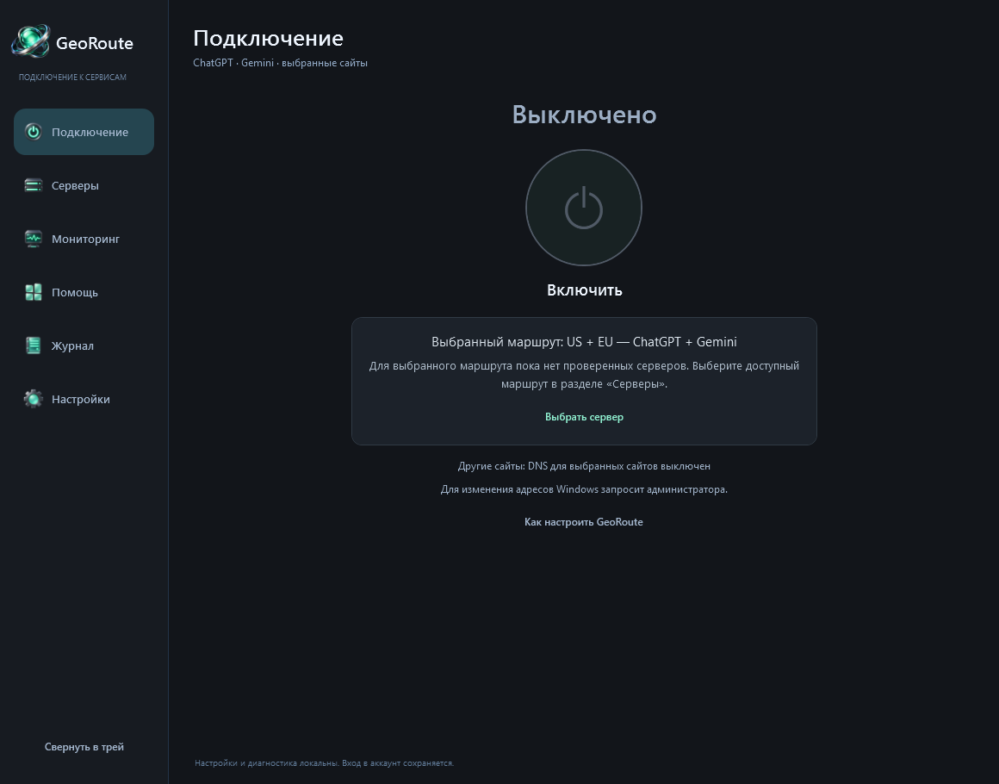
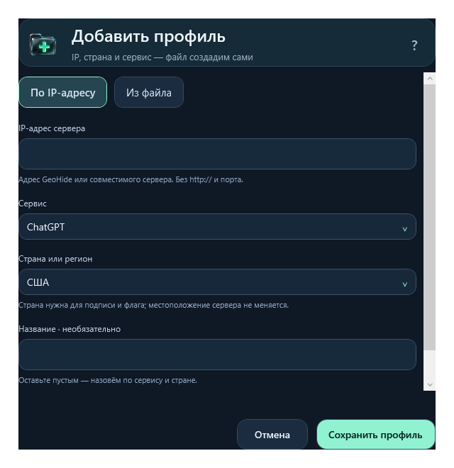
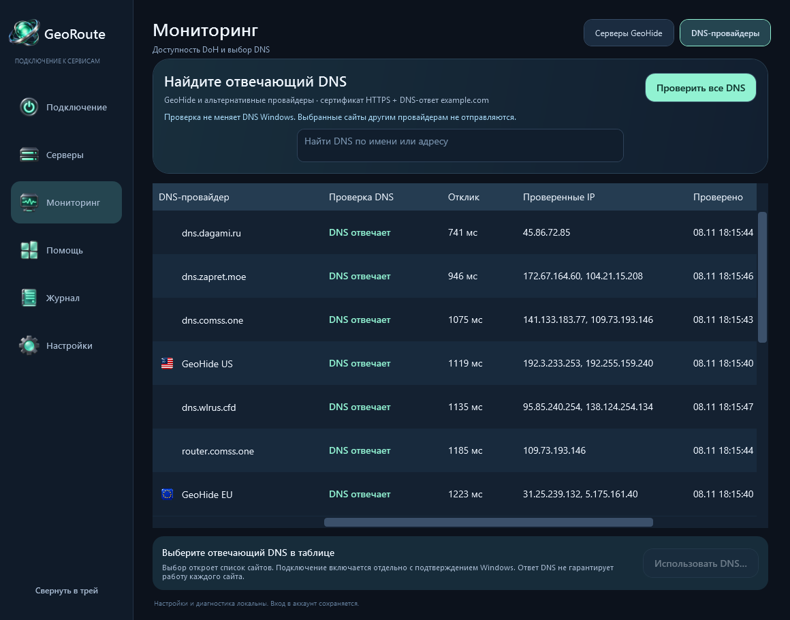

# GeoRoute

Windows desktop manager for ChatGPT and Gemini GeoHide routes and endpoint availability. [Русский](README.md).

**[Download GeoRoute 0.6.0 for Windows (MSI)](https://github.com/Georgy-hook/GeoRoute/releases/download/v0.6.0/GeoRoute-Setup-0.6.0-x64.msi)** · [Portable ZIP](https://github.com/Georgy-hook/GeoRoute/releases/download/v0.6.0/GeoRoute-Windows-x64-0.6.0.zip). Choose **Далее (Next) → Установить (Install)** in the Russian setup wizard, then open **GeoRoute** from the desktop or Start menu. Python and Java are not required. Requirements: Windows 10/11 x64, Windows PowerShell 5.1 and .NET Framework 4.8.

**VirusTotal snapshot (2026-11-28):** zero malicious or suspicious results for the exact 0.6.0 MSI, ZIP and 32 selected components. The MSI had 58 undetected results, one timeout and nine unsupported checks. This is not a safety guarantee. [Reports, scope and SHA-256](docs/security/README.md).

## What's new in 0.6.0

Connect a freshly verified GeoHide node from its monitoring row; Windows confirmation is still required. The selected IP is saved in one reusable card and regional auto selection does not overwrite it. The update keeps `gemini.gstatic.com` assets on Google, checks resource transport, preserves existing profile IPs and the shared Google route, retires the owner's closed RU pool, and includes `dns.geodema.love` and `w.quic.best` as DNS candidates. The default automatic interval is two hours, with a Never option in Settings.

On one Windows PC, TLS to the selected node timed out directly and succeeded after reconnecting through WARP. After an initial delay, the tester confirmed a fresh reply in a signed-in session on the official Gemini site. This was a manual browser check, not a trace of the generation request or a guarantee for other networks. [Method and limits](docs/VERIFICATION.md) · [Release notes](docs/releases/v0.6.0.md).

The per-user installer creates shortcuts and a Windows uninstall entry. Exit GeoRoute through its tray menu before updating; profiles/settings/logs are retained. Disable the route and optional Bridge/proxy before uninstalling. The portable ZIP is an additional option: extract it fully and run `GeoRoute.cmd`. Portable and installed settings are separate.

In 0.6.0, press **Подключиться (Connect)** on the home page. GeoRoute checks the selected profile directly first. Only a transport timeout with internet connectivity confirmed offers **Try via WARP** alongside **Retry directly**. Installation requires a separate opt-in, and an installed component is reused. A tunnel alone is not a successful result: GeoRoute checks the same profile again. Manual controls, logs, independent autostart and component removal are under **Дополнительно (Advanced)**.

In 0.6.0, server probes, active regional provider-list refresh and connection diagnostics run every two hours. **Settings → Automatic server checks** offers Never, 30 minutes, 1/2/6/12/24 hours (default: two hours). Choices persist and apply immediately, restarting the cooldown. Never also suppresses startup checks; manual checks remain available. An in-progress scan finishes normally. Observations remain usable between scans with a ten-minute allowance; with automation disabled they expire after two hours and ten minutes. In 0.5.0 these intervals were two minutes for servers, five minutes for connection health and one hour for provider lists. Regional replacement is independent: an EU outage does not prevent updating US profiles. Unavailable, retired and stale endpoints cannot unlock a managed profile. A mixed US+EU route requires both roles to pass. Healthy choices are retained; manual addresses survive provider refresh.

Monitoring has its own sidebar entry, overall and per-server loading indicators, and a single active scan. Every bundled GeoHide profile includes ChatGPT, Gemini and OpenAI files; the mixed route sends Gemini through EU. The retired Gemini-only cards are migrated away with a backup. Gemini failures are visible without disabling a working ChatGPT connection. Automatic selection prefers nodes without Google challenges. Managed profiles include the exact `www.google.com` verification frontend only after its same-node HTTPS or shared HTTP/2 route probe succeeds; this also routes Google Search on that hostname. Gmail, account login and other Google subdomains are not included.

Automatic selection updates saved profiles. Applying them to Windows requires an explicit connection action and elevation. The ordinary mode manages a marked section of `hosts`, not an all-traffic VPN. Closing the window keeps monitoring in the tray; exiting stops monitoring while applied hosts settings remain. Optional NextDNS Bridge and HTTP proxy features are not enabled automatically.

A green check proves the tested HTTPS transport/configuration only, not an authenticated ChatGPT conversation, a specific GIF download or computer-control session. Availability depends on the local network and GeoHide endpoints.

[Installation guide](docs/INSTALL.ru.md) · [Verification limits](docs/VERIFICATION.md) · [Development](docs/DEVELOPMENT.md) · [Changelog](CHANGELOG.md).

Based on [noVibe/DnsConf](https://github.com/noVibe/DnsConf). The upstream cloud DNS tools remain available separately: [technical manual](DNS-CONFIGURER.md). No NextDNS account or API key is needed for the ordinary desktop hosts mode. GeoRoute is an independent client, not an official GeoHide/NextDNS product.

Custom profiles: use the **?** button beside **Add server** for the in-app guide, or see the [file format and import limits](README.md#как-добавить-собственный-профиль). Import accepts `.hosts` files up to 1 MiB with 1–512 unique, supported exact domains. Importing adds a local profile without changing the active system configuration; selecting and connecting is a separate action. Custom profiles do not participate in automatic GeoHide endpoint replacement.

Create a profile without a file: **Servers → Add server → By IP**, enter a public server IP and choose the country, then save. One GeoHide profile includes ChatGPT, Gemini, OpenAI files and the exact Google verification frontend. A name is optional. Saving does not enable the route or verify connectivity; the supplied server must support these hosts. File import remains available as a separate input mode.

Available since 0.5.0: **Servers → Sites and DNS** routes only selected namespaces through GeoHide EU/US or another/custom HTTPS DoH endpoint. All other DNS stays unchanged. Includes a searchable GeoHide catalogue, custom domains, certificate-validated probes and a separate LocalService/NRPT route. [Scope and technical details](docs/SELECTIVE-DNS.md).

**Monitoring → DNS providers** performs read-only HTTPS DoH checks with certificate validation and a DNS answer for the fixed public `example.com`. Your site list is not sent to other candidates. Per-row loading, latency, checked bootstrap IPs, time and failures are visible; healthy results sort first. Select a successful result under five minutes old → **Set up this DNS…** to open the existing site list with that provider. Enabling it remains a separate elevated action. A healthy DNS transport does not guarantee support for any particular service. The saved custom DoH endpoint is also included. Both monitoring tables resize with the window.

*GeoRoute screen with local checks from 2026-11-08; availability and latency vary by network and time.*

For an existing selective VPN handling OpenAI/Telegram, see the [Gemini companion profile and verified fallback route](docs/SMARTDNS-ROUTES.ru.md). The current Zapret DoH preset is corrected; the profile is an explicit external example and is never applied automatically. Three GeoHide nodes answered through the existing VPN path while direct connections failed, so direct-path failure must not be described as a global server shutdown. That fallback-path test did not verify a signed-in model response; the separate 0.6.0 WARP test above did.
