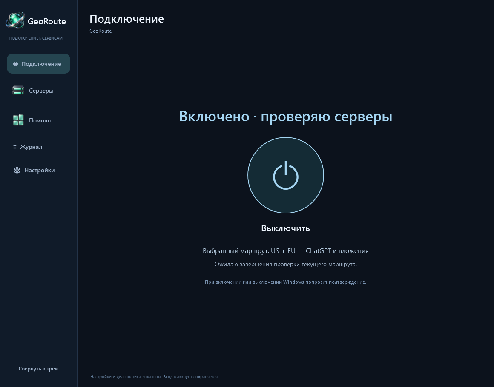

# GeoRoute

Приложение для Windows, которое помогает подключать ChatGPT, Gemini и вложения OpenAI через серверы GeoHide, проверяет доступность узлов и подбирает замену, когда адреса меняются.

**[Скачать GeoRoute для Windows](https://github.com/Georgy-hook/GeoRoute/releases/latest)** · [Установка по шагам](docs/INSTALL.ru.md) · [English](README.en.md)

> **VirusTotal, релиз 0.4.0:** есть срабатывания. ZIP и `GeoRoute.exe` — **2/71**, `NextDNSBridge.exe` — **3/71**, встроенный Python — **0/71**. Срабатывания пока не подтверждены как ложные. [Полные отчёты, даты и SHA-256](docs/security/virustotal-v0.4.0.md).



## Начать пользоваться

1. На странице релиза скачайте **GeoRoute-Windows-x64-0.4.0.zip**. «Source code» скачивать не нужно.
2. Нажмите на ZIP правой кнопкой → **Извлечь всё**. Сохраните всю папку, например в `Документы\GeoRoute`.
3. Откройте **GeoRoute.exe**. Устанавливать Python или Java не требуется.
4. Подождите первую проверку серверов. В разделе **Серверы** выберите доступный маршрут.
5. На главном экране нажмите **Включить** и подтвердите запрос Windows. Для отключения нажмите ту же кнопку ещё раз.

Для обычного режима не нужны аккаунт NextDNS, API-ключи или настройка GitHub. Нужны Windows 10/11 x64, системный Windows PowerShell 5.1 и .NET Framework 4.8.

## Что здесь есть

- **Подключение** — одна кнопка включения/выключения и понятное состояние текущего маршрута.
- **Серверы** — профили US, EU, RU и смешанный US + EU, отдельные профили Gemini; недоступные маршруты нельзя подключить.
- **Мониторинг** в боковом меню — флаги, проверки ChatGPT и Gemini по отдельности, задержки и история. Во время проверки виден прогресс, повторный запуск заблокирован, у каждого сервера показано ожидание или проверка. Ручной выбор IP свёрнут под списком.
- **Помощь** — объяснение DNS-кеша и помощник при проблемах с GIF, видео и ZIP. Подробная диагностика свёрнута.
- **Журнал** — история действий отдельно от главного экрана.
- **Настройки** — запуск в трее, анимации и дополнительные возможности.

Иконки и оформление обновлены с помощью Image Gen: [ассеты, промпты и дизайн-референс](docs/design/visual-refresh-v1.md).

## Как добавить собственный профиль

Кнопка **?** рядом с «Добавить сервер» и в окне импорта открывает пошаговую инструкцию. Встроенные профили уже готовы к использованию; импорт нужен для собственного списка адресов.

### Без файла: IP + страна + сервис

1. Откройте **Серверы → Добавить сервер → По IP-адресу**.
2. Введите публичный IP совместимого сервера без схемы URL, порта или маски сети. Поддерживаются IPv4 и IPv6.
3. Выберите **ChatGPT** или **Gemini**, затем страну/регион для подписи и флага.
4. Название необязательно: пустое поле будет заполнено по сервису и стране. Нажмите **Сохранить профиль**.
5. На новой карточке нажмите **Выбрать**, затем **Включить** на главной и подтвердите Windows.

Приложение генерирует локальный `.hosts` и запись каталога автоматически; создавать временный файл вручную не требуется. ChatGPT-профиль включает известные домены OpenAI и вложений, Gemini-профиль — только поддерживаемые домены Gemini. Все домены выбранного сервиса получают указанный IP. Для разделения ChatGPT и вложений по разным IP используйте готовый US+EU-профиль и его редактор в мониторинге.

Нужен сервер GeoHide или другой совместимый с выбранным сервисом сервер: произвольный IP, адрес обычного HTTP-прокси с портом или ключ VPN не превращается в подходящий сервер при сохранении. Страна — метаданные карточки, а не проверка местоположения. Сохранение не проверяет сетевую доступность и не меняет активное подключение.

### Импорт готового файла

В том же окне выберите **Из файла**, укажите `.hosts` до 1 МиБ, название и страну, затем нажмите **Сохранить профиль**. ZIP сначала распакуйте. VPN-ссылки, `.ovpn`, JSON и `.hosts.txt` не подходят. Новый профиль подключается отдельно, как описано выше.

### Формат файла

Каждая строка содержит публичный IP и одно или несколько точных доменных имён, разделённых пробелами. Пустые строки и комментарии после `#` допускаются. Пример синтаксиса:

```text
# Демонстрационные адреса: замените их на рабочие адреса вашего сервера.
203.0.113.10 chatgpt.com www.chatgpt.com
203.0.113.10 auth.openai.com
203.0.113.20 files.oaiusercontent.com
203.0.113.20 gemini.google.com
203.0.113.20 gemini.google
203.0.113.20 bard.google.com
203.0.113.20 geminiweb-pa.clients.google.com
203.0.113.20 geminiweb-pa.clients6.google.com
203.0.113.20 generativelanguage.googleapis.com
203.0.113.20 geller-pa.googleapis.com
203.0.113.20 proactivebackend-pa.googleapis.com
203.0.113.20 robinfrontend-pa.googleapis.com
```

Это пример формата, а не готовый рабочий профиль: адреса `203.0.113.*` используются только для документации. Для полного ChatGPT-профиля берите текущий [встроенный список доменов](clients/windows/_service/profiles/us-eu.hosts) и актуальные адреса GeoHide или своего совместимого сервера. Обычный произвольный IP не становится Smart DNS от добавления в файл.

Ограничения импорта:

- До **1 МиБ**, от **1 до 512 уникальных доменов**; повторяющийся домен отклоняется, даже если IP одинаковый.
- Публичный IPv4 или IPv6; loopback, частные и локальные адреса отклоняются. URL, порты, маски сети и `*.` вместо точного домена не поддерживаются.
- Разрешены `chatgpt.com`, `openai.com`, `oaistatic.com`, `oaiusercontent.com` и их поддомены; для Gemini — только [точный список поддерживаемых имён](clients/windows/_service/GeoServices.ps1). Общие `google.com`, `accounts.google.com`, Gmail и произвольные Google API не разрешены.
- Приложение копирует профиль в `_service/profiles/` и регистрирует его в `_service/profiles.json`. Исходный файл после импорта не нужен. Прямое редактирование этих файлов не требуется.
- Импорт проверяет синтаксис и допустимые домены, **не доступность сервера**. Пользовательская карточка не получает автоматическую замену IP от GeoHide; при отказе нужен обновлённый профиль от поставщика.

Если имеется только новый IP GeoHide, для общей пары откройте **Мониторинг → Адреса US + EU → Вручную**. Сначала сохраните новый адрес без подключения и выполните проверку, затем нажмите **Сохранить и подключить**. Кнопка добавления IP в мониторинг добавляет узел для проверок, а не создаёт отдельную карточку профиля.

## Как работает подбор адресов

GeoRoute обновляет опубликованные списки **всех трёх регионов** раз в час и проверяет серверы каждые две минуты, пока приложение работает. Ручные адреса сохраняются отдельно. Ручной режим фиксирует выбранную пару US/EU; отдельные региональные профили продолжают обновляться. Если источник временно недоступен, прежний список остаётся.

US, EU и RU обновляются независимо. Рабочий адрес сохраняется, пока он доступен. Если EU для вложений перестал отвечать, приложение подберёт другой EU, не меняя рабочий US. Если подходящего узла нет, карточка объяснит причину и не позволит подключить неполный маршрут. Профили других регионов продолжают обновляться. Удалённые провайдером узлы отмечаются отдельно; устаревшая проверка не считается подтверждением доступности.

**Автоподбор обновляет сохранённые профили. Применение в Windows происходит только по кнопке подключения с подтверждением администратора.** Уже включённое соединение не переключается скрытно. Чтобы применить обновлённый маршрут, подключите его на экране серверов либо выключите и снова включите на главном экране.

## ChatGPT и Gemini

Смешанный профиль **US + EU — ChatGPT + Gemini** направляет ChatGPT через US, Gemini и файлы OpenAI через EU. Для Gemini без ChatGPT выберите **Gemini — EU** или **Gemini — US**: такой профиль проверяется и обновляется независимо от ChatGPT и не направляет через GeoHide Gmail, Google-поиск или вход в аккаунт.

Мониторинг проверяет HTTPS страницы Gemini и его API отдельно. Если Google отвечает страницей CAPTCHA, карточка остаётся доступной с предупреждением **«Проверка Google»**. Подключите маршрут и откройте Gemini в браузере: проверку Google проходит сам пользователь. Это не считается ни тайм-аутом GeoHide, ни подтверждением работающего ответа модели. Настоящий отказ HTTPS блокирует профиль.

## Что меняется на компьютере

Обычный режим добавляет управляемый блок адресов в системный `hosts` и обновляет DNS-кеш. Прочие записи сохраняются, создаётся резервная копия. Это маршруты для поддерживаемых доменов, а не VPN-туннель для всего интернета. GeoRoute — независимый клиент; серверы GeoHide обслуживает другой проект, и их доступность зависит в том числе от провайдера пользователя.

Зелёный статус подтверждает актуальные сетевые проверки и настройку маршрута. Он не означает проверенную авторизацию в ChatGPT, скачивание конкретной GIF или работу управления компьютером. Для этого нужны соответствующие действия внутри приложения ChatGPT. Проверка соединений использует обычную проверку HTTPS-сертификатов.

Настройки hosts сохраняются после перезагрузки. Если закрыть окно, GeoRoute останется в трее; полный выход останавливает мониторинг. Необязательные NextDNS Bridge и HTTP-прокси находятся в дополнительных настройках и автоматически не включаются.

## Если не подключается

- **Все карточки недоступны:** дождитесь проверки. Если адреса не отвечают с вашего подключения, программа покажет это; другой регион может оказаться доступен.
- **US работает, EU недоступен:** смешанный профиль заблокирован до появления доступного EU. Отдельный доступный US/EU/RU профиль можно выбрать отдельно.
- **GIF или ZIP зависли после смены сервера:** откройте «Помощь». Очистка DNS-кеша не закрывает уже открытые соединения браузера.
- **Вручную:** «Мониторинг» → «Адреса US + EU» → «Вручную». Выберите IP US/EU и нажмите «Сохранить и подключить». Новый адрес сначала сохраните без подключения и проверьте.

[Подробная установка и удаление](docs/INSTALL.ru.md) · [Ограничения проверок](clients/windows/VERIFICATION.md) · [История версий](CHANGELOG.md)

## Для разработчиков

Исходники клиента: [`clients/windows`](clients/windows). Проверки и сборка описаны в [руководстве разработчика](docs/DEVELOPMENT.md). Версия macOS пока не выпущена: [план](docs/macos-client.md).

Проект развивает форк [noVibe/DnsConf](https://github.com/noVibe/DnsConf). Инструменты настройки облачных правил сохранены: [NextDNS / Cloudflare — расширенная документация](DNS-CONFIGURER.ru.md). Для обычного использования GeoRoute они не требуются. Источники и компоненты: [THIRD_PARTY.md](THIRD_PARTY.md).
