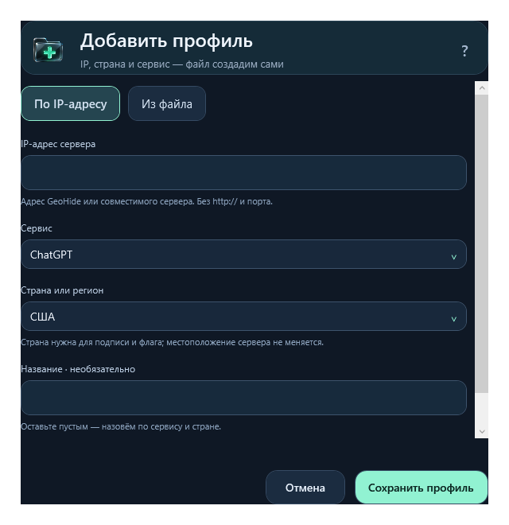

# GeoRoute

[](https://github.com/Georgy-hook/GeoRoute/releases/latest)
[](docs/INSTALL.ru.md)
[](https://www.virustotal.com/gui/file/0134f84ebf9c1b7ca51cb9bb408d199db913c93559fa6885f938c308a15e4c9a/detection)

Приложение для Windows, которое помогает подключать ChatGPT, Gemini и вложения OpenAI через серверы GeoHide, проверяет доступность узлов и подбирает замену, когда адреса меняются.

**[Скачать установщик GeoRoute для Windows](https://github.com/Georgy-hook/GeoRoute/releases/download/v0.4.3/GeoRoute-Setup-0.4.3-x64.msi)** · [Установка по шагам](docs/INSTALL.ru.md) · [Все релизы](https://github.com/Georgy-hook/GeoRoute/releases) · [English](README.en.md)


> **VirusTotal · снимок от 06.11.2026:** ноль обнаружений у MSI 0.4.3, ZIP и восьми выбранных компонентов. У MSI 58 ответов `undetected`, один тайм-аут и 12 неподдерживаемых проверок; это не гарантия безопасности. [Отчёты, охват, даты и SHA-256](docs/security/README.md).


## Начать пользоваться

1. На странице релиза скачайте **GeoRoute-Setup-0.4.3-x64.msi**. «Source code» и ZIP для обычной установки не нужны.
2. Откройте скачанный файл → **Далее → Установить**. Ярлыки появятся на рабочем столе и в меню **Пуск**.
3. Откройте **GeoRoute** с ярлыка. Подождите первую проверку серверов; в разделе **Серверы** выберите доступный маршрут.
4. На главной нажмите **Включить** и подтвердите запрос Windows. Для отключения нажмите ту же кнопку ещё раз.

Для обычного режима не нужны аккаунт NextDNS, API-ключи, GitHub, отдельная установка Python или Java. Нужны Windows 10/11 x64, системный Windows PowerShell 5.1 и .NET Framework 4.8. Установщик добавляет приложение для текущего пользователя и сам не меняет DNS, hosts или прокси.

**Обновление:** закройте GeoRoute через значок в трее → **Выход**, затем запустите новый Setup. Профили, настройки и журнал сохраняются. **Удаление:** сначала выключите подключение в приложении, затем удалите GeoRoute через **Параметры Windows → Приложения**.

**Без установки:** ZIP оставлен как дополнительный вариант. Извлеките всю папку и откройте `GeoRoute.cmd` — появится тот же графический интерфейс. Настройки ZIP-версии и установленного приложения хранятся отдельно; автоматического переноса между ними нет.

## Что здесь есть

- **Подключение** — одна кнопка включения/выключения и понятное состояние текущего маршрута.
- **Серверы** — общие профили GeoHide: основной и запасной EU, основной и запасной US, RU и смешанный US + EU. В каждый включены ChatGPT, Gemini и вложения; ограничения Gemini показаны отдельно.
- **Мониторинг** в боковом меню — флаги, проверки ChatGPT и Gemini по отдельности, задержки и история. Во время проверки виден прогресс, повторный запуск заблокирован, у каждого сервера показано ожидание или проверка. Ручной выбор IP свёрнут под списком.
- **Помощь** — объяснение DNS-кеша и помощник при проблемах с GIF, видео и ZIP. Подробная диагностика свёрнута.
- **Журнал** — история действий отдельно от главного экрана.
- **Настройки** — запуск в трее, анимации и дополнительные возможности.

Иконки и оформление обновлены с помощью Image Gen: [ассеты, промпты и дизайн-референс](docs/design/visual-refresh-v1.md).

## Другие сайты и GeoHide DNS · следующая версия 0.5.0

В разработке есть **Серверы → Сайты и DNS**. Эта возможность ещё не входит в стабильную 0.4.3 по ссылке выше. GeoRoute может направлять через выбранный DNS отдельные сайты, сохраняя прежний DNS для остальных запросов.

1. Выберите **GeoHide EU**, US, RU или другой DoH-провайдер. Пресеты из сообщения владельца — адреса для проверки, а не обещание доступности; в списке отмечено сообщение о блокировке RU.
2. Найдите сайт в [каталоге GeoHide](https://github.com/Internet-Helper/GeoHideDNS/blob/main/lists/domains.txt) и нажмите **Добавить выбранный сайт**, либо вставьте ссылку/домен в поле справа и нажмите **+**. Для сервисов из нескольких доменов добавьте связанные имена. Список разрешено редактировать, по одному сайту в строке.
3. Выберите, включать ли поддомены. **Проверить DNS** покажет результаты HTTPS DoH по каждому адресу без изменения подключения.
4. Нажмите **Включить / обновить** и подтвердите Windows. **Сохранить список** только сохраняет выбор. Для отключения используйте **Выключить** в том же окне.

Это не универсальный VPN: сайт должен поддерживаться выбранным DNS-провайдером. Каталог описывает GeoHide; у альтернатив поддержка может отличаться. Успех DNS-проверки не доказывает вход в аккаунт или полную работу сайта. Свои домены разрешены и вне каталога, с явным сообщением о неподтверждённой поддержке.

Режим работает через отдельную службу и правила Windows только для выбранных имён. Настройка сохраняется после выхода из GeoRoute и перезагрузки; DNS сетевых адаптеров и NextDNS Bridge остаются прежними. Основная кнопка на главной управляет hosts-профилем ChatGPT/Gemini; состояние DNS других сайтов показано отдельной строкой. Пересекающиеся hosts или DNS-политики нужно устранить перед включением: приложение не подменяет их скрытно. [Технические детали и ограничения](docs/SELECTIVE-DNS.md).

## Как добавить собственный профиль

Кнопка **?** рядом с «Добавить сервер» и в окне импорта открывает пошаговую инструкцию. Встроенные профили уже готовы к использованию; импорт нужен для собственного списка адресов.

### Без файла: IP + страна



*Форма добавления общего профиля GeoHide. Профиль можно добавить прямо в приложении.*

1. Откройте **Серверы → Добавить сервер → По IP-адресу**.
2. Введите публичный IP совместимого сервера без схемы URL, порта или маски сети. Поддерживаются IPv4 и IPv6.
3. Выберите страну/регион для подписи и флага. ChatGPT, Gemini и вложения включены вместе.
4. Название необязательно: получится, например, **GeoHide — Германия**. Нажмите **Сохранить профиль**.
5. На новой карточке нажмите **Выбрать**, затем **Включить** на главной и подтвердите Windows.

Приложение генерирует локальный `.hosts` и запись каталога автоматически; создавать временный файл вручную не требуется. Профиль по IP объединяет известные домены OpenAI, вложений и Gemini. Точный `www.google.com` нужен для проверки Google через тот же сервер; он также обслуживает Google Поиск. Нужен сервер с поддержкой всех этих имён. Для разных IP ChatGPT и вложений используйте US + EU и редактор в мониторинге.

Нужен сервер GeoHide или другой совместимый с выбранным сервисом сервер: произвольный IP, адрес обычного HTTP-прокси с портом или ключ VPN не превращается в подходящий сервер при сохранении. Страна — метаданные карточки, а не проверка местоположения. Сохранение не проверяет сетевую доступность и не меняет активное подключение.

### Импорт готового файла

В том же окне выберите **Из файла**, укажите `.hosts` до 1 МиБ, название и страну, затем нажмите **Сохранить профиль**. ZIP сначала распакуйте. VPN-ссылки, `.ovpn`, JSON и `.hosts.txt` не подходят. Новый профиль подключается отдельно, как описано выше.

### Формат файла

Каждая строка содержит публичный IP и одно или несколько точных доменных имён, разделённых пробелами. Пустые строки и комментарии после `#` допускаются. Пример синтаксиса:

```text
# Демонстрационные адреса: замените их на рабочие адреса вашего сервера.
203.0.113.10 chatgpt.com www.chatgpt.com
203.0.113.10 auth.openai.com
203.0.113.20 files.oaiusercontent.com
203.0.113.20 gemini.google.com
203.0.113.20 gemini.google
203.0.113.20 bard.google.com
203.0.113.20 geminiweb-pa.clients.google.com
203.0.113.20 geminiweb-pa.clients6.google.com
203.0.113.20 generativelanguage.googleapis.com
203.0.113.20 geller-pa.googleapis.com
203.0.113.20 proactivebackend-pa.googleapis.com
203.0.113.20 robinfrontend-pa.googleapis.com
```

Это пример формата, а не готовый рабочий профиль: адреса `203.0.113.*` используются только для документации. Для полного ChatGPT-профиля берите текущий [встроенный список доменов](clients/windows/_service/profiles/us-eu.hosts) и актуальные адреса GeoHide или своего совместимого сервера. Обычный произвольный IP не становится Smart DNS от добавления в файл.

Ограничения импорта:

- До **1 МиБ**, от **1 до 512 уникальных доменов**; повторяющийся домен отклоняется, даже если IP одинаковый.
- Публичный IPv4 или IPv6; loopback, частные и локальные адреса отклоняются. URL, порты, маски сети и `*.` вместо точного домена не поддерживаются.
- Разрешены `chatgpt.com`, `openai.com`, `oaistatic.com`, `oaiusercontent.com` и их поддомены; для Gemini — только [точный список поддерживаемых имён](clients/windows/_service/GeoServices.ps1). Общие `google.com`, `accounts.google.com`, Gmail и произвольные Google API не разрешены.
- Приложение копирует профиль в `_service/profiles/` и регистрирует его в `_service/profiles.json`. Исходный файл после импорта не нужен. Прямое редактирование этих файлов не требуется.
- Импорт проверяет синтаксис и допустимые домены, **не доступность сервера**. Пользовательская карточка не получает автоматическую замену IP от GeoHide; при отказе нужен обновлённый профиль от поставщика.

Если имеется только новый IP GeoHide, для общей пары откройте **Мониторинг → Адреса US + EU → Вручную**. Сначала сохраните новый адрес без подключения и выполните проверку, затем нажмите **Сохранить и подключить**. Кнопка добавления IP в мониторинг добавляет узел для проверок, а не создаёт отдельную карточку профиля.

## Как работает подбор адресов

GeoRoute обновляет опубликованные списки **всех трёх регионов** раз в час и проверяет серверы каждые две минуты, пока приложение работает. Ручные адреса сохраняются отдельно. Ручной режим фиксирует выбранную пару US/EU; отдельные региональные профили продолжают обновляться. Если источник временно недоступен, прежний список остаётся.

US, EU и RU обновляются независимо. Рабочий адрес сохраняется, пока он доступен. Если EU для вложений перестал отвечать, приложение подберёт другой EU, не меняя рабочий US. Если подходящего узла нет, карточка объяснит причину и не позволит подключить неполный маршрут. Профили других регионов продолжают обновляться. Удалённые провайдером узлы отмечаются отдельно; устаревшая проверка не считается подтверждением доступности.

**Автоподбор обновляет сохранённые профили. Применение в Windows происходит только по кнопке подключения с подтверждением администратора.** Уже включённое соединение не переключается скрытно. Чтобы применить обновлённый маршрут, подключите его на экране серверов либо выключите и снова включите на главном экране.

## ChatGPT и Gemini

Все встроенные профили GeoHide объединяют ChatGPT, Gemini и вложения OpenAI. Смешанный **US + EU — ChatGPT + Gemini** направляет ChatGPT через US, Gemini и файлы через EU. Отдельные карточки Gemini US/EU и старый профиль «Вложения 25.10» больше не создаются. При обновлении каталог сохраняется в резервную копию; остальные пользовательские профили остаются.

Мониторинг проверяет Gemini, его API и `www.google.com` через один узел. Управляемый профиль добавляет `www.google.com` только после успешной проверки, включая Google Поиск на этом имени. Gmail, `accounts.google.com` и остальные поддомены Google не перенаправляются. Автовыбор предпочитает узлы без ограничения Google. Если Gemini недоступен, общий профиль сохраняет рабочий ChatGPT и показывает предупреждение; зелёного подтверждения Gemini не будет.

Страница Google с двумя разными IP и без поля ввода не позволяет пройти CAPTCHA. Gemini и проверка Google должны идти через один IP. GeoRoute проверяет общий HTTP/2-маршрут; отдельное соединение с `www.google.com` требуется не на всех узлах. После запуска Chrome сначала откройте Gemini. Очистка кеша не исправляет неподдерживаемый сервером маршрут. [Разбор и действия](docs/INSTALL.ru.md#если-google-показывает-два-разных-ip).

## Что меняется на компьютере

Обычный режим добавляет управляемый блок адресов в системный `hosts` и обновляет DNS-кеш. Прочие записи сохраняются, создаётся резервная копия. Это маршруты для поддерживаемых доменов, а не VPN-туннель для всего интернета. GeoRoute — независимый клиент; серверы GeoHide обслуживает другой проект, и их доступность зависит в том числе от провайдера пользователя.

Зелёный статус подтверждает актуальные сетевые проверки и настройку маршрута. Он не означает проверенную авторизацию в ChatGPT, скачивание конкретной GIF или работу управления компьютером. Для этого нужны соответствующие действия внутри приложения ChatGPT. Проверка соединений использует обычную проверку HTTPS-сертификатов.

Настройки hosts сохраняются после перезагрузки. Если закрыть окно, GeoRoute останется в трее; полный выход останавливает мониторинг. Необязательные NextDNS Bridge и HTTP-прокси находятся в дополнительных настройках и автоматически не включаются.

## Если не подключается

- **Все карточки недоступны:** дождитесь проверки. Если адреса не отвечают с вашего подключения, программа покажет это; другой регион может оказаться доступен.
- **US работает, EU недоступен:** смешанный профиль заблокирован до появления доступного EU. Отдельный доступный US/EU/RU профиль можно выбрать отдельно.
- **GIF или ZIP зависли после смены сервера:** откройте «Помощь». Очистка DNS-кеша не закрывает уже открытые соединения браузера.
- **Вручную:** «Мониторинг» → «Адреса US + EU» → «Вручную». Выберите IP US/EU и нажмите «Сохранить и подключить». Новый адрес сначала сохраните без подключения и проверьте.

[Подробная установка и удаление](docs/INSTALL.ru.md) · [Что проверяется](docs/VERIFICATION.md) · [История версий](CHANGELOG.md)

## Для разработчиков

Исходники клиента: [`clients/windows`](clients/windows). Проверки и сборка описаны в [руководстве разработчика](docs/DEVELOPMENT.md). Версия macOS пока не выпущена: [план](docs/macos-client.md).

Проект развивает форк [noVibe/DnsConf](https://github.com/noVibe/DnsConf). Инструменты настройки облачных правил сохранены: [NextDNS / Cloudflare — расширенная документация](DNS-CONFIGURER.ru.md). Для обычного использования GeoRoute они не требуются. Источники и компоненты: [THIRD_PARTY.md](THIRD_PARTY.md).
